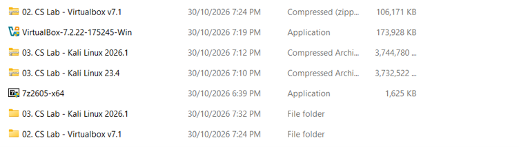
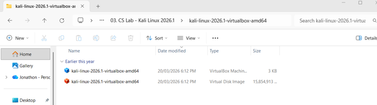
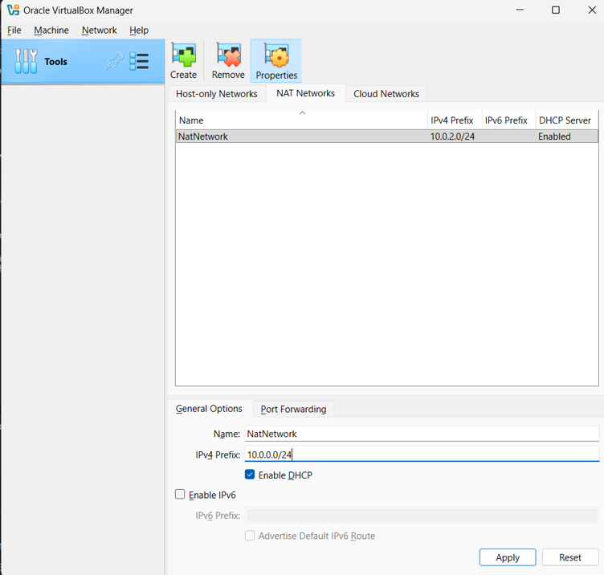
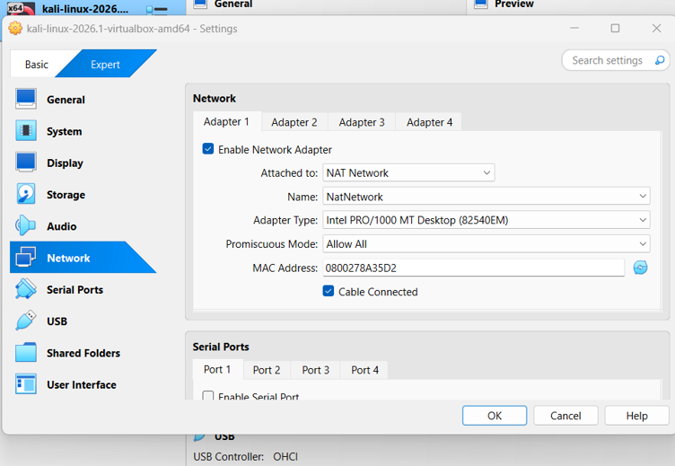
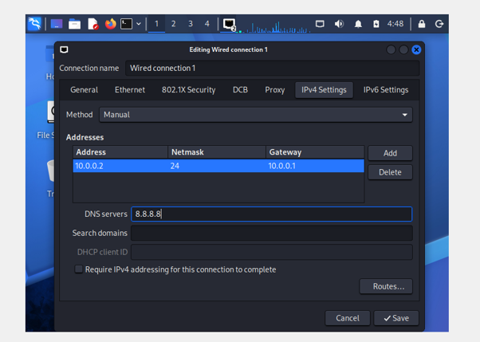
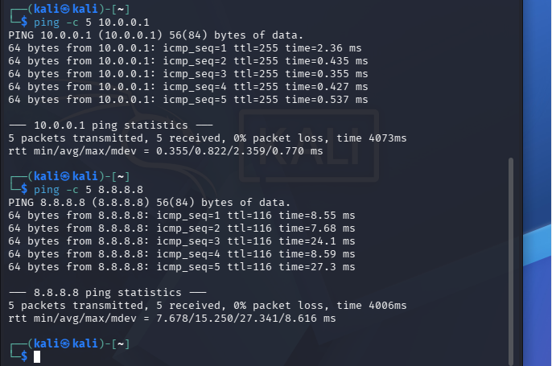
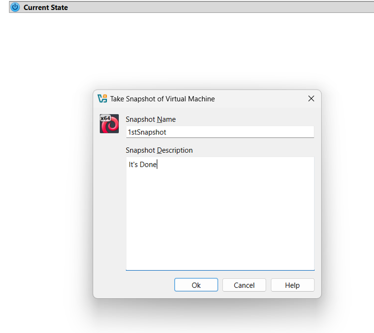

  
# NETWORKWALKS-B084-WEEK1-PM1
This project involves establishing a virtualised cybersecurity laboratory using VirtualBox, Kali Linux and a private NAT Network.

## Project Overview
This project documents the deployment and configuration of a Kali Linux virtual machine within Oracle VirtualBox. The objective was to establish a functional and reproducible cybersecurity laboratory environment for future networking and security exercises. The implementation involved importing a prebuilt Kali Linux virtual machine, configuring a dedicated NAT Network, manually assigning IPv4 network settings, verifying connectivity and creating a recovery snapshot. The resulting environment provides a controlled foundation for future cybersecurity activities without requiring additional physical hardware.

## Objectives
- Install and configure VirtualBox and import a prebuilt Kali Linux virtual machine.
- Establish a dedicated private NAT Network for the virtual laboratory.
- Configure Kali Linux with a static IPv4 address, subnet prefix, default gateway and DNS server.
- Verify connectivity between the virtual machine, its default gateway and an external IP address.
- Create a VirtualBox snapshot to preserve the initial configuration and provide a recovery point.
- Document the configuration process and verification results to support reproducibility and troubleshooting.

## Lab Architecture
| Component | Configuration |
| --------- | -------------- |
| Host OS | Windows 11 |
| Virtualisation Platform | Oracle VirtualBox |
| Lab OS | Kali Linux 2026.3 |
| Network Type | NAT Network |
| Network Name | NatNetwork |
| Network Prefix | 10.0.0.0/24 |
| Kali IP Address | 10.0.0.2 |
| Subnet Mask | 255.255.255.0 (/24) |
| Default Gateway | 10.0.0.1 |
| DNS Server | 8.8.8.8 |
| DHCP | Enabled |

The laboratory uses a private IPv4 subnet (`10.0.0.0/24`) to provide a shared network environment for virtual machines connected to the `NatNetwork` interface.

Kali Linux uses a manually assigned static IPv4 address (`10.0.0.2`), while DHCP remains enabled to accommodate additional virtual machines. This provides predictable addressing for the primary security testing machine while maintaining flexibility for future laboratory expansion.

# Lab Setup Procedure

## Step 1 - Preparing VirtualBox and Kali Linux

Installed Oracle VirtualBox and downloaded the prebuilt Kali Linux virtual machine archive from the official Kali Linux website.

After downloading the archive, I extracted its contents using 7-Zip. The extracted directory contained a `.vbox` virtual machine configuration file and a `.vdi` virtual disk image.

The `.vbox` file contains the virtual machine's configuration settings, while the `.vdi` file stores its virtual hard disk data. These files were used to register and initialise the Kali Linux environment within VirtualBox.

## Step 2 - Creating the NAT Network

Opened VirtualBox's Network Manager and created a dedicated NAT Network to provide a shared private network for the laboratory environment.

The following configuration was applied:

- **Network Name:** NatNetwork
- **IPv4 Prefix:** 10.0.0.0/24
- **DHCP Server:** Enabled

The `/24` prefix provides 254 usable IPv4 host addresses. Enabling DHCP allows additional virtual machines to obtain network configurations automatically, while Kali Linux retains its manually assigned address.

## Step 3 - Selecting the Correct Network Adapter

Accessed the Kali Linux virtual machine's network settings within VirtualBox and configured Adapter 1 to use the previously created NAT Network.

Selected `NatNetwork` as the network interface to ensure that Kali Linux was connected to the dedicated laboratory subnet.

This configuration allows the virtual machine to communicate with other machines attached to the same NAT Network and access external networks through VirtualBox's network address translation.

## Step 4 - Configuring Kali Linux IPv4 Settings

Accessed Kali Linux's wired connection settings and changed the IPv4 configuration method from Automatic to Manual.

The following network parameters were entered:

| Network Parameter | Assigned Value |
| ----------------- | -------------- |
| IPv4 Address | 10.0.0.2 |
| Prefix Length | 24 |
| Default Gateway | 10.0.0.1 |
| DNS Server | 8.8.8.8 |

A static IPv4 address was selected to provide consistent network identification for the Kali Linux machine. This is particularly useful for future cybersecurity exercises involving network scanning, service discovery and communication between laboratory machines.

The default gateway (`10.0.0.1`) provides the route outside the local subnet, while `8.8.8.8` specifies Google's public DNS resolver for domain name resolution.

## Step 5 - Verifying Network Connectivity

After configuring the network settings, I performed connectivity tests through Kali Linux's terminal using the `ping` utility.

Two tests were conducted to establish whether the virtual machine could communicate with its default gateway and reach an external IP address.

| Tests | Command | Observed Output | Outcome |
| ----- | ------- | --------------- | ------- |
| Default Gateway | `ping -c 5 10.0.0.1` | 0% Packet Loss | Successful |
| External Connectivity | `ping -c 5 8.8.8.8` | 0% Packet Loss | Successful |

Both tests returned 0% packet loss, demonstrating successful communication with the configured default gateway and an external IP address.

These results provide initial evidence that the NAT Network and IPv4 configuration are functioning correctly.

It is important to distinguish IP connectivity from DNS resolution. Although the DNS server was configured, the ping tests used IP addresses directly. A separate domain resolution test, such as `nslookup google.com`, would be required to independently verify DNS functionality.

## Step 6 - Creating a Recovery Snapshot

After completing the network configuration and connectivity checks, I created a VirtualBox snapshot named **1stSnapshot**.

The snapshot preserves the virtual machine's state at the time of creation and provides a recovery point if future cybersecurity exercises result in unwanted configuration changes or system instability.

Maintaining a clean baseline is particularly valuable in cybersecurity laboratories, where experimentation may involve modifying network settings, installing tools or testing potentially disruptive configurations.

## The Outcome

The Kali Linux virtual machine was successfully imported, configured and connected to the dedicated `NatNetwork` environment.

The laboratory was established with a manually assigned IPv4 address, configured default gateway and DNS resolver. Connectivity testing demonstrated successful communication with the gateway and an external IP address, with both tests returning 0% packet loss.

A recovery snapshot was also created to preserve the initial configuration and provide a baseline for future laboratory activities.

Overall, the project established a functional virtualised cybersecurity environment that can be expanded with additional virtual machines and used for subsequent networking and security exercises.

## Challenges and Troubleshooting

- **Antivirus Detection and File Integrity Verification:** Microsoft Defender flagged the downloaded Kali Linux `.7z` archive as a potential security threat. Rather than immediately trusting or executing the downloaded files, I used Windows PowerShell to calculate the archive's SHA-256 hash and compared the result against the checksum published on the official Kali Linux website. The matching hashes established that the downloaded archive was identical to the official release corresponding to the published checksum. After completing the integrity verification, I restored the archive and successfully extracted its contents. This highlighted the importance of software provenance and cryptographic integrity verification when obtaining operating system images and security tools.

- **Static Addressing and DHCP Configuration:** A configuration consideration involved using a manually assigned IPv4 address while keeping DHCP enabled on the VirtualBox NAT Network. DHCP provides automatic network configuration to connected virtual machines, whereas a static address provides predictable addressing for machines requiring consistent network identification. I assigned Kali Linux the address `10.0.0.2/24`, configured `10.0.0.1` as the default gateway and specified `8.8.8.8` as the DNS resolver. Additional virtual machines will use addresses within the planned `10.0.0.3-10.0.0.99` range, subject to the DHCP allocation range and address availability to prevent duplicate IP assignments.

## What I Learned

1. **Virtualisation:** Learned how VirtualBox manages virtual machines and how `.vbox` configuration files and `.vdi` virtual disk images work together to establish a virtual computing environment.

2. **Network Architecture and NAT:** Developed an understanding of NAT Network configuration, private IPv4 addressing and how multiple virtual machines can communicate through a shared virtual subnet.

3. **IPv4 Addressing:** Gained practical experience configuring static IPv4 addresses, subnet prefixes, default gateways and DNS resolvers. Also developed an understanding of the relationship between DHCP and static addressing.

4. **Connectivity Testing:** Used the `ping` utility to assess connectivity between the virtual machine, its default gateway and an external IP address. Identified the distinction between successful IP connectivity and independently verified DNS resolution.

5. **Recovery Planning:** Learned how VirtualBox snapshots preserve virtual machine states and provide recovery points before undertaking potentially disruptive technical exercises.

6. **Security Practices and Documentation:** Applied software integrity verification using SHA-256 checksums and documented the laboratory configuration through screenshots, observed outputs and procedural explanations.

## Responsible & Ethical Use

This laboratory is intended exclusively for educational purposes and authorised cybersecurity activities.

Any future vulnerability assessments, penetration testing, network scanning or security experiments will be restricted to systems that I own or for which I have received explicit permission to conduct testing.

The laboratory provides a controlled environment for developing practical cybersecurity skills while reinforcing the importance of responsible testing, authorisation and professional conduct.

## Resources

- [Oracle VirtualBox - Official Downloads](https://www.virtualbox.org/wiki/Downloads)
- [Kali Linux - Official Download Page](https://www.kali.org/get-kali/)

## Author Information

**Joshua Kwon**

Cybersecurity Intern | Networkwalks B084

[LinkedIn Profile](https://www.linkedin.com/in/joshua-kwon-05914337a/)

## Project Information
| Field | Details |
| ----- | ------- |
| Program Name | Cybersecurity at Networkwalks |
| Networkwalks ID | B084 |
| Week | 01 |
| Project | Cybersecurity Lab Environment Setup |
| Project Reference | NETWORKWALKS-B084-WEEK1-PM1 |
